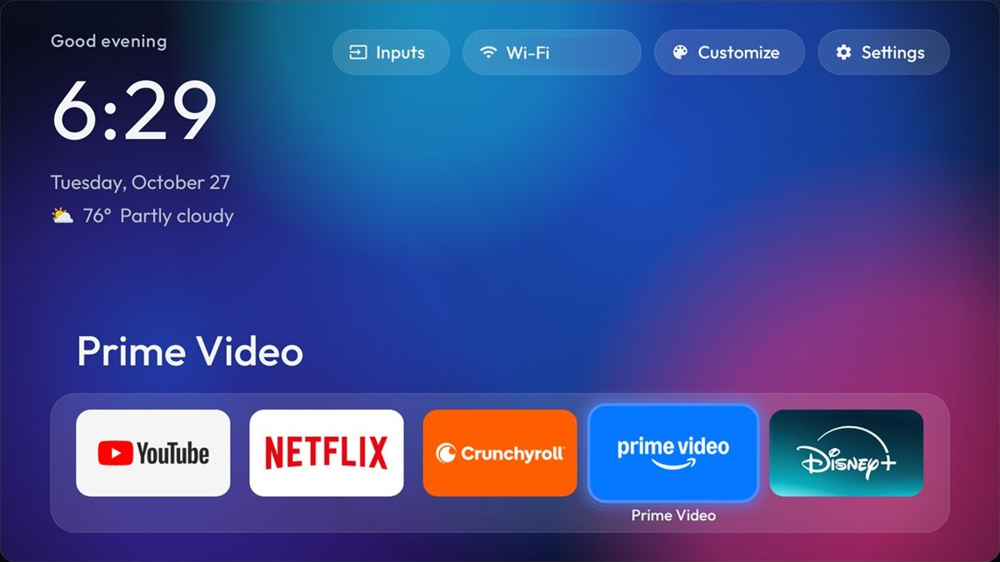
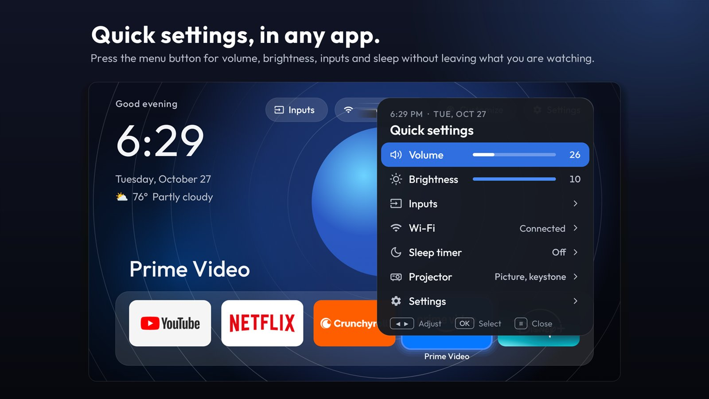
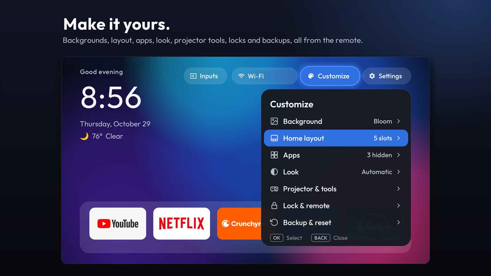
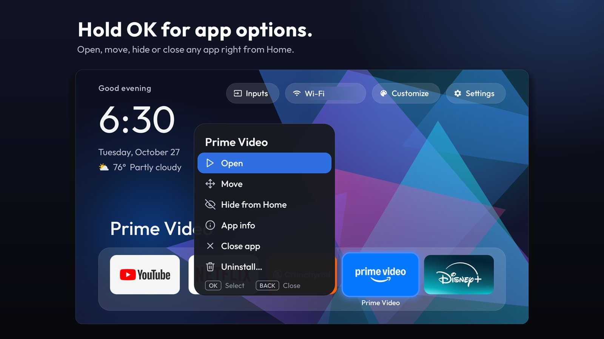
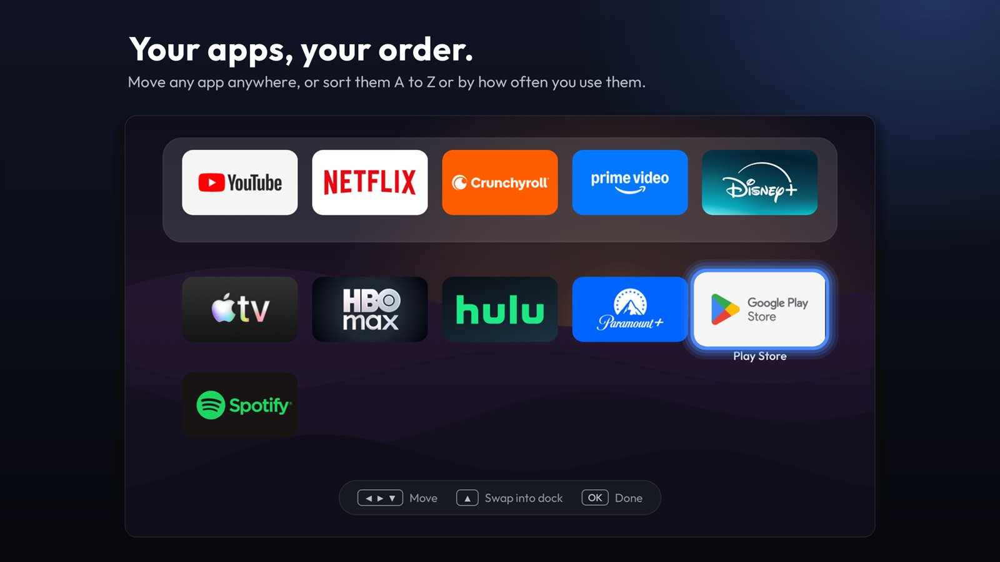
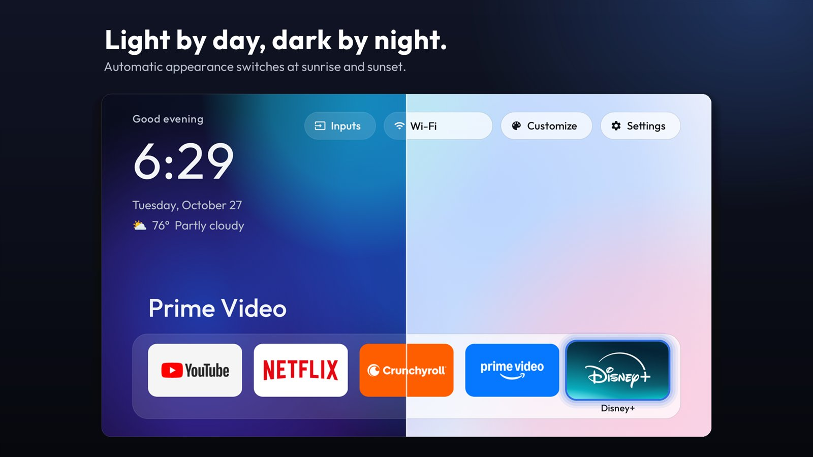
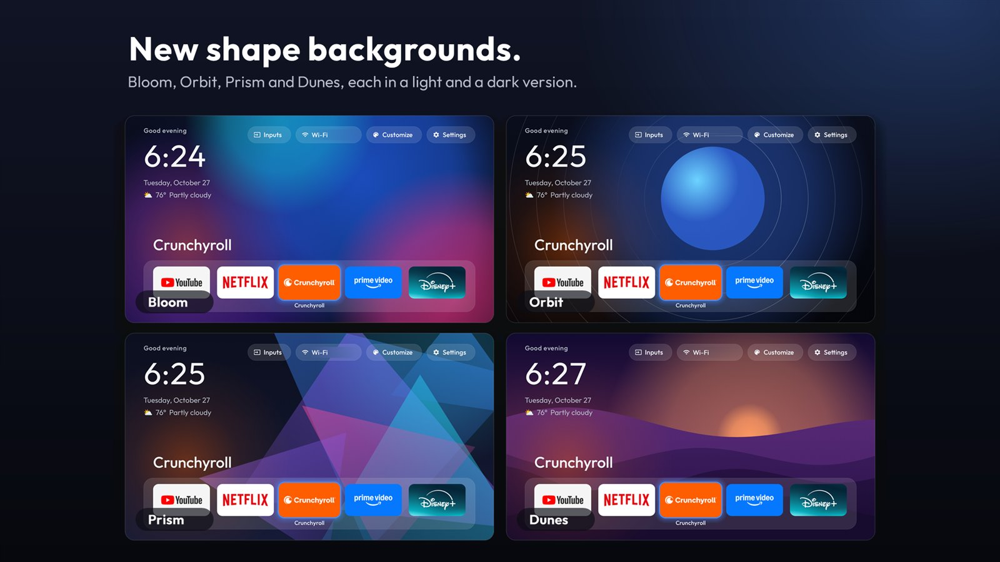

# Leios Launcher

A clean, ad-free home screen for Android TV and Google TV, written from scratch in plain Java. Say it "LAY-os": it comes from the ancient Greek word for smooth.

There are no accounts, no ads and no tracking. It's controlled entirely from the remote.



| | |
|---|---|
|  |  |
|  |  |
|  |  |

App logos in the screenshots belong to their owners. They're shown only because those apps were installed on the test device.

## Before you start

**Provided as is, with no warranty. You use it at your own risk.** This project isn't made or approved by JMGO, Google or any TV maker.

- **It changes your device.** Installing a home screen, and especially using the optional setup kit, changes how your device behaves. A wrong change can break features such as casting, voice search or updates.
- **The last resort is a factory reset,** which erases everything on the device. Know how to do one on your model before you start.
- **It may affect your warranty or support,** and a firmware update can undo or break some changes.
- **Network debugging opens a door on your network.** While it's on, any device on your Wi-Fi can ask to connect. The TV shows a prompt, so only accept your own PC, and turn debugging off when you're done.

## Supported devices

| Device | Status |
|---|---|
| JMGO N3 4K (reports itself as K970AN), Google TV, Android 14 | **Tested** |
| Other Android TV and Google TV devices, Android 9 or later | **Not tested.** May work, but behaviour will vary |

The JMGO-only rows hide themselves on other devices, but that has never been tested on a non-JMGO device.

## Features

- **Home:** a dock, an app grid, categories, and moving, hiding and renaming apps.
- **Search on Home:** find apps and Leios settings as you type, with a keyboard made for the remote. Optionally also movies and shows on your streaming apps, from TMDB (off until you turn it on). Open it with the **Search** button, **Up** at the top of Home, or holding **Home**.
- **Customize:** a quick sheet for background, appearance and the dock, and a full **Customization** screen with every setting.
- **Quick settings on the ≡ button, in any app:** volume, brightness, inputs, Wi-Fi and sleep timer.
- **Backgrounds:** colours, shapes, photos, GIFs, a slideshow, video, and an optional online photo of the day.
- **Look:** light, dark or automatic, plus fonts, clock, top bar, tile styles, accent colour, themes and optional sounds.
- **Weather:** for a city you type in.
- **Projector tools:** picture, brightness and keystone shortcuts, test patterns, sleep timer, and start-up and wake options. Some of these are JMGO-only.
- **Lock:** PIN lock, app locks, schedules and guest mode.
- **Backup:** save and restore your settings, with automatic backups.
- **Extras:** a clock screensaver, icon packs and a notification bell.

Icon packs have only been tested with a test pack. Bluetooth and ARC auto-mute, full-motion film backgrounds, right-to-left languages and large text haven't been tested on hardware.

## Known issues

- **Interface sounds on TVs that mute system sounds.** Some TVs, the JMGO N3 4K among them, mute Android's System sound channel at every start, so sounds sent there are never heard (Android's own clicks are silent too). With **Sounds › Output › Automatic** (the default), Leios notices and plays its sounds at your TV's media volume instead, without pausing or lowering other apps. On other TVs Automatic keeps using system sounds. If you hear nothing, **Sounds › Output** says why.
- **Bluetooth and ARC speakers:** sounds are off there by default (**Silent on Bluetooth or ARC**), because those outputs add a delay. This hasn't been tested with real Bluetooth or ARC audio.
- **Search and the remote's mic button:** on the tested projector the mic button goes straight to Google's remote service, so no app can receive it. Search uses the on-screen keyboard. Voice input hasn't been added.
- **Movies & TV in search** can't open a title directly in an app: TMDB doesn't give apps' own title IDs. Hulu, Crunchyroll and YouTube open their own search with the title filled in; other apps open, and a note says what to search for. Which apps do what was read from what they declare on the tested projector and still needs checking on hardware.
- **Holding Home** needs the ≡ helper (Leios quick settings) on. It works only on Leios's Home and never delays a normal Home press. Turn it off in **Lock & remote › Remote shortcuts**.
- **Disabling or uninstalling Leios while it's still a device admin** (for the sleep timer) can make the TV unresponsive until a reboot. Deactivate it first in Settings › Device admin apps.

## Build from source

You need JDK 17 and the Android SDK with platform 34 and build-tools 34.0.0. Android Studio can install the SDK. The Gradle wrapper downloads Gradle itself.

Windows PowerShell, from the repo root (swap in your own paths):

```powershell
$env:JAVA_HOME = 'C:\path\to\jdk-17'
$env:ANDROID_HOME = 'C:\path\to\android-sdk'
cd launcher
.\gradlew.bat assembleDebug
.\gradlew.bat testDebugUnitTest
.\gradlew.bat lintDebug
```

The debug APK lands in `launcher\app\build\outputs\apk\debug\`. It's signed with your own automatic debug key.

**Online title search** needs a free TMDB key. Copy `launcher\tmdb.properties.example` to `launcher\tmdb.properties` and put your key in it, or set `TMDB_API_KEY`. The file is git-ignored. Without a key, Leios builds as normal and search finds apps and settings only. Any key built into an APK can be read out of it, so don't put your key into builds you publish unless you accept that. For the same reason, the public GitHub build doesn't use one.

**Release builds** need your own signing key, and never use the debug key. Without one, `assembleRelease` stops with a message saying what's missing. To sign, copy `launcher\keystore.properties.example` to `launcher\keystore.properties` and fill it in, or set the `LEIOS_*` environment variables listed there. Or run `.\dev-tools\build-release.ps1 -Keystore <path>`, which asks for the password and keeps it out of files. Keep the key outside the repo, and never commit it.

## Set up on a TV

These steps use ADB from a Windows PC, and were tested only on the device above.

1. **Get the app.** Download `leios-launcher-<version>.apk` from [Releases](https://github.com/leioslauncher/leios-launcher/releases/latest), and check its SHA-256 matches the one on the release page:

   ```powershell
   Get-FileHash .\leios-launcher-1.2.apk
   ```

   Or build it yourself (above).
2. **Get the scripts.** Download this repo (Code › Download ZIP) and unzip it.
3. On the TV, go to Settings > System > About and press Build 7 times. Then turn on **USB debugging** in Developer options.
4. Install [Android platform-tools](https://developer.android.com/tools/releases/platform-tools) so `adb` is available, or unpack them into `platform-tools\` in this repo.
5. Open PowerShell in the repo folder. Windows blocks scripts by default, so first allow them for this window only:

   ```powershell
   powershell -ExecutionPolicy Bypass
   ```

   Then install the APK and make it Home:

   ```powershell
   $env:TV_HOST = '192.0.2.10'   # your TV's IP address
   .\setup-kit\install.ps1 -Apk C:\path\to\leios-launcher-1.2.apk
   ```
6. Accept the "Allow USB debugging?" prompt on the TV.
7. For the ≡ panel, turn on **Leios quick settings** in Settings > System > Accessibility.
8. For the notification bell, allow it over ADB (Google TV may not show this setting):

   ```powershell
   .\setup-kit\tv.ps1 -Cmd 'cmd notification allow_listener tv.leios.launcher/tv.leios.launcher.Notifs'
   ```

9. Turn USB debugging off when you're done.

To use the clock as the screensaver, run this once:

```powershell
.\setup-kit\tv.ps1 -Cmd 'settings put secure screensaver_components tv.leios.launcher/.Screensaver'
```

Avoid **Force stop** on the launcher. Android then turns the ≡ panel off until you re-enable it in Accessibility.

Backups are saved as pictures in `Pictures/Leios`. Leios can also restore backups and themes saved before the project was renamed, from `Pictures/Clean Home`; it only reads those, never changes them.

## Undo everything

Network debugging needs to be on. To hand Home back and undo the setup kit:

```powershell
.\setup-kit\restore.ps1
.\setup-kit\tv.ps1 -Cmd reboot
```

To remove the launcher too:

1. On the TV, turn off its sleep-timer permission: Settings › Privacy (or Security) › **Device admin apps** › **Leios** › Deactivate. ADB can't do this step: Android refuses to remove a normal device admin from the command line.
2. Then uninstall it:

   ```powershell
   .\setup-kit\tv.ps1 -Cmd 'pm uninstall tv.leios.launcher'
   ```

Don't disable or uninstall Leios while it's still a device admin. On the tested projector, disabling an app that was still a device admin left the system unresponsive until a reboot.

## What's in this repo

| Folder | What |
|---|---|
| `launcher/` | The app. It builds on its own and doesn't depend on anything else here |
| `setup-kit/` | **Optional** ADB scripts: install, debloat, restore and the HDR fix. See its [README](setup-kit/README.md) |
| `dev-tools/` | Test, measurement and screenshot scripts. See its [README](dev-tools/README.md) |
| `docs/` | Screenshots |

## More

- [Privacy](PRIVACY.md)
- [Changelog](CHANGELOG.md)
- [Contributing](CONTRIBUTING.md)
- [Security](SECURITY.md)
- [Third-party notices](THIRD_PARTY_NOTICES.md)

## License

GPL-3.0. See [LICENSE](LICENSE). The fonts have their own license; see the [notices](THIRD_PARTY_NOTICES.md).
